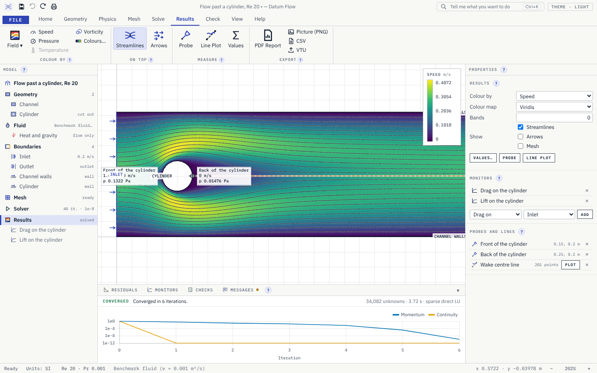

<p align="center"></p>

<h1 align="center">Datum Flow</h1>

<p align="center">Fluid flow simulation: draw it, set the flow, see and check the results.</p>

<p align="center">
  <a href="https://github.com/Edgar-Mendonca/Datum-Flow/releases"></a>
  <a href="https://github.com/Edgar-Mendonca/Datum-Flow/actions/workflows/ci.yml"></a>
  <a href="https://github.com/Edgar-Mendonca/Datum-Flow/releases"></a>
  
  
  
  
  
</p>

<p align="center">
  <a href="https://github.com/Edgar-Mendonca/Datum-Flow/releases/latest"></a>
  <a href="CHANGELOG.md"></a>
  <a href="docs/MEMORY.md"></a>
</p>



Datum Flow simulates fluid flow on the desktop. Draw a region or pick a template, choose the fluid, say where it comes in, where it leaves and where the walls are; Datum Flow meshes it, solves it and shows the velocity, pressure and temperature, with the numbers engineers need: pressure drop, flow rate, drag and lift, heat transfer. Every release proves its answers in a built-in verification report.

It is for mechanical, process, HVAC and energy engineers, researchers, students and lecturers. It is free and open source (MIT), Windows first, installs in seconds and updates itself. More on the family site: [edgar-mendonca.github.io/Datum/apps/flow](https://edgar-mendonca.github.io/Datum/apps/flow).

## What it does

- **Geometry (2D):** rectangles, circles, polygons and arcs, added together or cut out as bodies; templates for a channel, cavity, step, cylinder in a channel and heated box; exact coordinates, a snap grid, a name for every edge.
- **Fluid:** water, air and a light oil at a chosen temperature, each value with its source, or your own. SI and US units.
- **Boundaries:** velocity inlets (uniform or fully developed), pressure outlets, fixed and moving walls, symmetry lines; temperatures and heat fluxes. A check before solving refuses, and says why, when there is no outlet, an edge has no boundary, temperatures are set with heat off, or the flow is probably turbulent.
- **Mesh:** automatic six-node triangles with refinement at walls, corners and wakes, and a quality report.
- **Solve:** steady laminar flow, with heat and natural convection; residuals and monitors plotted as it runs; stop and resume; plain advice when it does not converge.
- **Results:** contours, arrows and streamlines; probes and line plots; flow rate, pressure drop, drag and lift, wall heat flow and Nusselt number.
- **Verification:** exact solutions, order of accuracy and published benchmarks, in [docs/VERIFICATION.md](docs/VERIFICATION.md) and in Help › Verification.

- **Exports:** PDF report, VTU (opens in free viewers such as ParaView), CSV, PNG; DXF outlines in; `flow-cli` runs a model from the command line.

The [changelog](CHANGELOG.md) lists every release, and the [roadmap](docs/MEMORY.md) says where it is heading.

## How it compares with known answers

| Case | Published | Datum Flow |
| --- | ---: | ---: |
| Cylinder in a channel, Re 20: drag coefficient (Schäfer & Turek 1996) | 5.57954 | 5.57958 |
| Lid-driven cavity, Re 1000: stream function at the eddy centre (Botella & Peyret 1998) | −0.118937 | −0.118935 |
| Heated cavity, Ra 10⁵: Nusselt number (de Vahl Davis 1983) | 4.519 | 4.522 |

All 36 checks, their tolerances and what is not verified are in [docs/VERIFICATION.md](docs/VERIFICATION.md).

## How it works

Datum Flow has its own solver, written in Rust inside the app: Taylor–Hood finite elements (quadratic velocity and temperature, linear pressure) on six-node triangles, one coupled system solved by Picard then Newton iterations with a sparse direct factorisation. The mesher is built on [spade](https://github.com/Stoeoef/spade) and the linear algebra on [faer](https://codeberg.org/sarah-quinones/faer).

## Build from source

```bash
npm ci
npm run build:ui
cargo test --workspace
npm run tauri build
```

## Licence

MIT, © 2026 Edgar Mendonca. Third-party parts are listed in [NOTICE](NOTICE).

Product and file-format names are trademarks of their owners and are used only to describe file compatibility.
